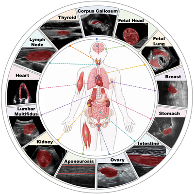
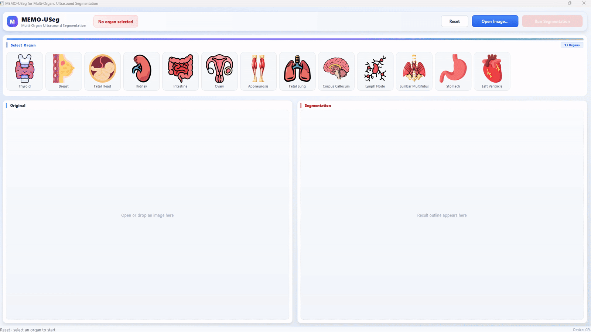

<h1 align="center">MEMO-USeg</h1>

  <b>An Organ-Conditioned Self-Prompting Multi-Expert Framework for Multi-Organ Ultrasound Image Segmentation</b>

  

---

MEMO-USeg is an organ-conditioned, self-prompting multi-expert framework for multi-organ ultrasound image segmentation. It enables a single model to jointly learn multiple organ segmentation tasks and can be extended to new organs after training by adding organ-specific experts (SOEM).

## 📄 Paper

This repository provides the official implementation of MEMO-USeg.

**MEMO-USeg: An Organ-Conditioned Self-Prompting Multi-Expert Framework for Multi-Organ Ultrasound Image Segmentation** — **Under Review**

### ✨ Key Features

- **One model, multiple organs.** Through multi-expert joint learning on multi-organ images, a single model performs automatic segmentation across multiple organs.
- **Broad organ coverage.** Validated on ultrasound images covering 13 organs.
- **Extensible organ-incremental learning.** By adding organ-specific experts (SOEM) and freezing previously trained SOEMs, the model preserves its ability on existing organs while adapting to new ones.
- **Prompt-free deployment.** No manual bounding box or point prompts are required.

  

<i>Examples from the 13 ultrasound organs covered by MEMO-USeg.</i>

## 🏥 Clinical Application

In clinical use, the operator only needs to select the target organ in the MEMO-USeg interface and upload the corresponding ultrasound image; the organ is then segmented automatically. A single model handles multi-organ segmentation without any manual box or point prompts.

  

<i>Select an organ and upload an ultrasound image — segmentation is fully automatic.</i>

## ⚙️ Installation and Getting Started

To be added.
